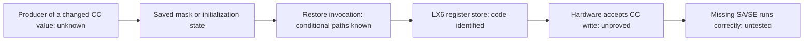

# Status at the pause

**Research paused on 9 November 2026. No unlock, no complete CC modification chain, no deployable patch.** Repository packaging did not resume hardware experiments.

## What is established

| Finding | Evidence level | Consequence |
| --- | --- | --- |
| All three boards execute 60 CU / 30 WGP, missing one whole SE | Register maps plus physical HW_ID observations and exact arithmetic checks | The outer SA gate is the primary target; surviving arrays are already full |
| Fifteen CC SA/WGP writes ignored; eight USER writes accepted and restored | 23 transient trials | Ordinary writes do not establish a CC override; USER is a positive control only |
| PowerColor USER WGP control produces 60 → 58 → 60 CU | Physical dispatch and exact outputs | Cached API counts alone are insufficient |
| A hot whole-SA disable hung a queue and triggered one MODE1 reset | Incident and recovery receipts | Do not repeat this test |
| VFCT selected A/A/A while exact-BDF records are A/B/C | Driver source and extracted tables | Wrong BIOS selection is real, but not a proven harvesting control |
| LX6 `71ac` saves/restores CC WGP/RB and USER WGP/RB | Byte-checked code and address definitions | A local copy path exists; changed inputs, invocation and acceptance remain unproved |
| Main restore route needs byte `5ffee452 != 0` | Local path analysis | No established nonzero producer for that gate |
| SMU command41 has indirect worker selection and a final byte store | Local code and initial tables | Runtime tables, address relations and delivery still matter; not a CC write proof |

Hardware evidence: [main report](../navi21-unlock-report.md), [invasive report](../navi21-invasive-report.md), [completion audit](../evidence/navi21-unlock/invasive-v1/completion-audit.json).

## The incomplete chain

The known copy routine covers WGP/RB fields. It does **not** by itself solve the observed outer `CC_GC_SA_UNIT_DISABLE` gate. Keep that distinction when evaluating every candidate path.

## Latest completed step

The last offline audit enumerated command41's initial pointer table: 42,453 image-backed cells, with 23,083 possible selector cells outside the examined image. Only one numeric match to the reviewed CC/state coordinate hypotheses was found: value `0x89bc`, cell `0x13b94`, selector `0x3a1`. Existing consumers use `0x89bc` as a bit coordinate (word `0x44d`, bit 28), not a demonstrated direct CC address. The final byte-at-base store would not touch documented WGP bits 16–31 even under a hypothetical little-endian direct alias. [Receipt](../evidence/navi21-unlock/disassembly-v1/smu-command41-pointer-candidates-audit.json).

## Scope of this public export

Only GPU measurements, firmware analysis and reproduction inputs are relevant here. Identifying metadata and unrelated operational state are excluded. No current hardware-state audit was performed as part of packaging. Research remains paused.
